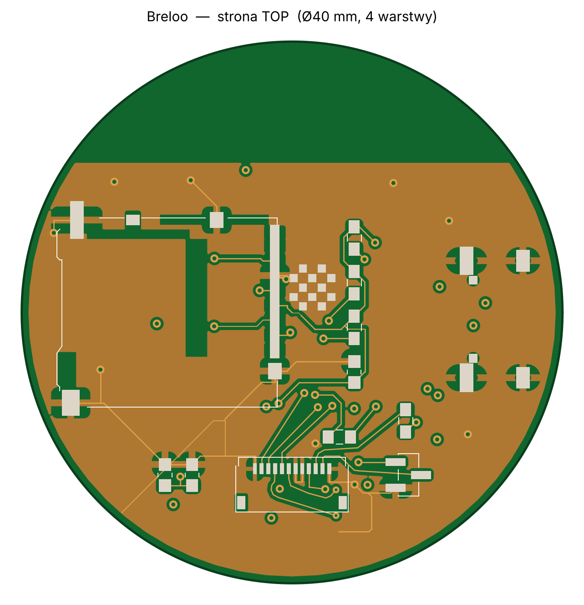
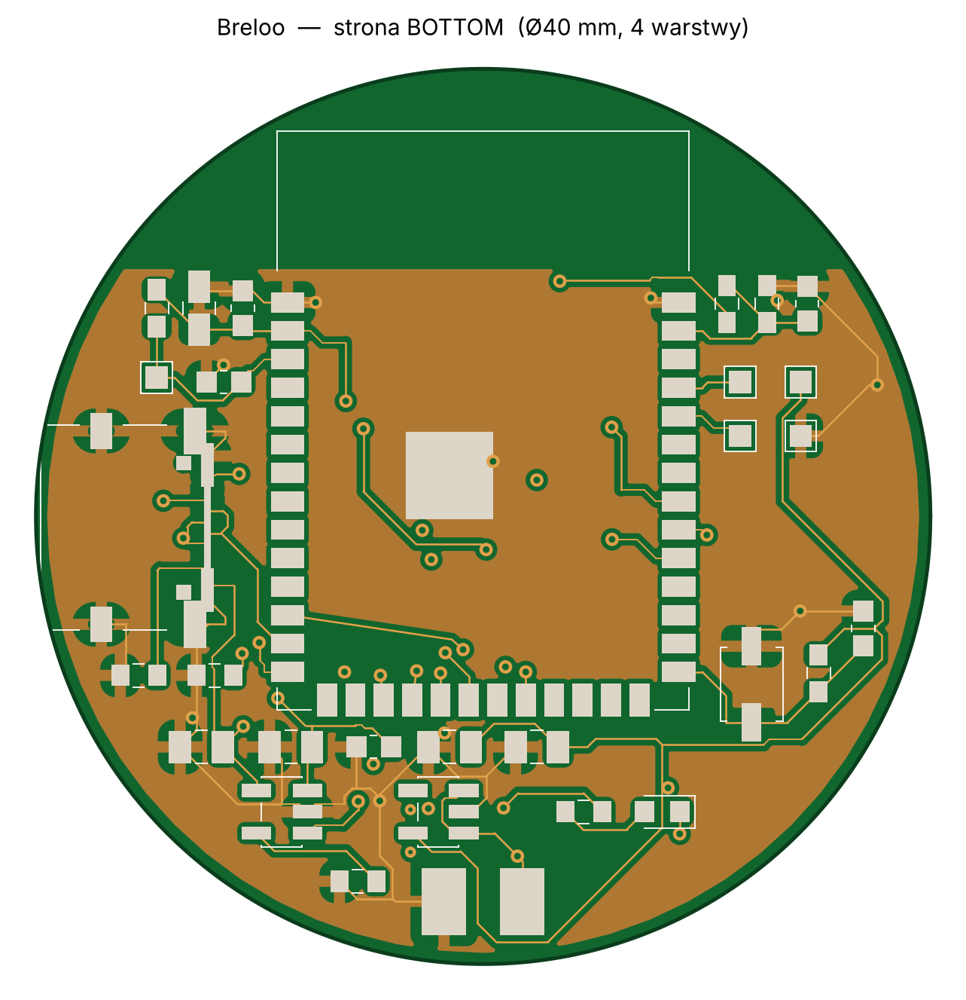
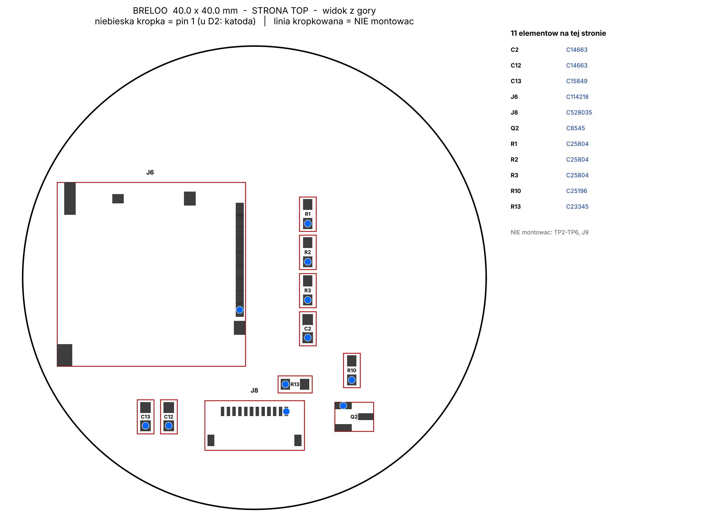
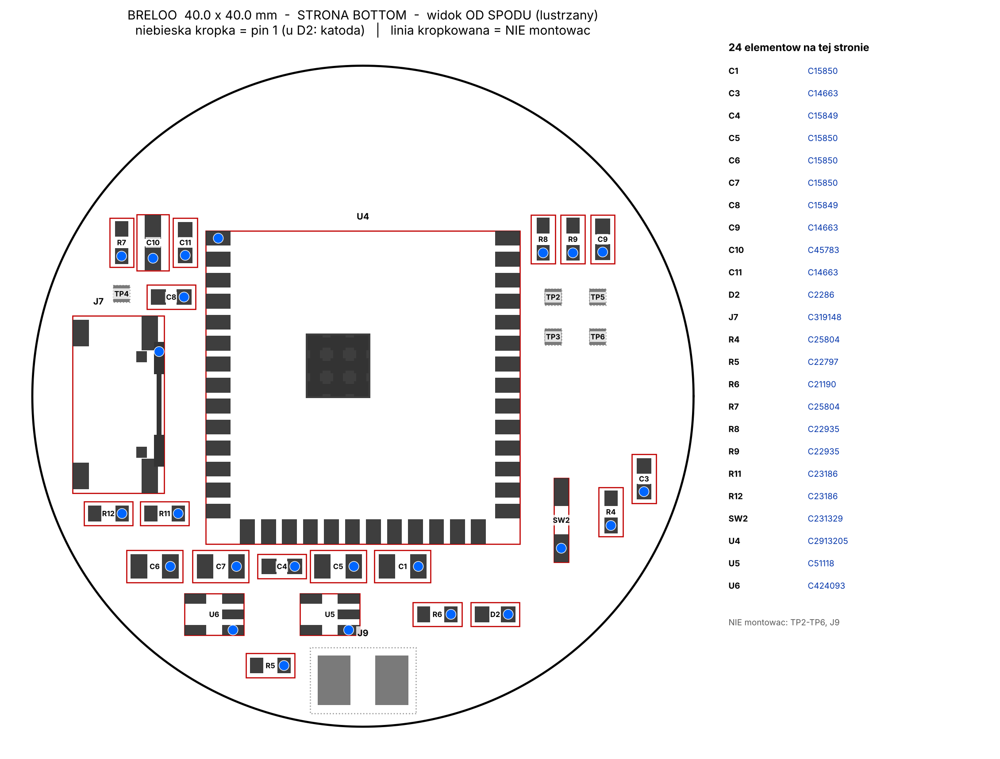

# Breloo — a round video keychain

A Ø40 mm keychain that plays actual video. A 1.28" round GC9A01 LCD on the front,
an ESP32-S3 and a microSD slot on the back, a 3.7 V LiPo and USB-C charging.
Drop MP4-derived frames on the card, clip it to your keys, and it loops video in
your pocket.

I am a high-school student from Poland. This is my first 4-layer board and my
first board with a fine-pitch FPC connector.




## What it does

- Plays video and images from a microSD card on a 240×240 round IPS display
- Charges over USB-C, runs from a 400 mAh LiPo
- Backlight is PWM-dimmable from the MCU
- Battery voltage is measured through a divider so the firmware can show charge level
- Fits a 3D-printed case that clips onto a keyring

## Specs

| | |
|---|---|
| Board | Ø40.0 mm circle, 4 layers, 1.6 mm FR-4 |
| MCU | ESP32-S3-WROOM-1-N16R2 (16 MB flash, 2 MB PSRAM) |
| Display | GC9A01 1.28" round IPS 240×240, 12-pin 0.5 mm FPC |
| Storage | microSD (Hirose DM3AT-SF-PEJM5), 1-bit SPI |
| Power | USB-C 5 V → MCP73831 charger → 3.7 V LiPo → AP2112K-3.3 LDO |
| Battery | LP402025, 3.7 V, ~400 mAh |
| Stack-up | F.Cu signals / In1 solid GND / In2 solid +3V3 / B.Cu signals |
| Design rules | 0.2 mm trace / 0.2 mm clearance, 0.6/0.3 mm vias |
| Components | 35 placed parts, 11 top / 24 bottom |
| DRC | 0 errors, 0 unconnected, schematic/PCB parity clean |

## The interesting problem: the display tape is reversed

The GC9A01 flex tape leaves the panel pointing *away* from the board, loops 180°
and comes back into the connector. A 180° fold keeps left and right the same but
flips which face of the tape meets the board, so two things had to change:

1. **The connector has to be dual-contact.** I used XKB `X05A10H12G` (LCSC
   `C528035`), which has contacts on both the top and the bottom of the slot, so
   which way the tape faces stops mattering.
2. **The pad numbering is reversed in the footprint.** In
   `Biblioteka.pretty/FPC_0.5mm_12P_Horizontal_CableReversed.kicad_mod`, pad *N*
   is **display FPC contact N**, not connector pin N. Without this the whole
   12-wire bus lands mirrored and the display never initialises.

The land pattern is taken 1:1 from the JLCEDA/EasyEDA Official Library footprint
`FPC-SMD_X05A10H12G`, so it matches the part the assembler would actually place:
signal pads 0.30 × 0.80 mm on 0.50 mm pitch, hold-downs 0.60 × 1.00 mm at ±3.75 mm.

Footprint geometry source: JLCEDA/EasyEDA Official Library —
https://lceda.cn/ and https://easyeda.com

## Routing notes

Seven display signals have to cross from the left of the FPC connector to targets
on the right, inside a 40 mm circle that is already mostly taken by a 25.5 × 18 mm
radio module. Getting all seven across with 0.2 mm clearance needed the connector
sitting exactly on the board axis — 0.8 mm off and two of them have no legal path.

The inner GND plane is solid except where a battery trace crosses it, and the
plane pair is stitched with vias around the module. One GND pour island above the
connector carries the display's two GND pins and is tied down with a dedicated
stitching via, after nudging a VBAT trace on In1 by 0.4 mm to make room.

## Files

```
images/        board renders, assembly drawings
gerbers/       Breloo-gerbery-JLCPCB-v2.zip — Gerber X2 + Excellon, 12 files
kicad/         full KiCad 10 project: schematic, PCB, custom footprint library
bom/           BOM with LCSC part numbers, and a pick-and-place file
Breloo-schemat.pdf
```

## BOM summary

20 unique parts, ~$8.89 of components per board.

| Part | Designators | LCSC |
|---|---|---|
| ESP32-S3-WROOM-1-N16R2 | U4 | C2913205 |
| microSD socket DM3AT-SF-PEJM5 | J6 | C114218 |
| MCP73831T-2ACI/OT charger | U6 | C424093 |
| USB-C receptacle U262-161N-4BVC11 | J7 | C319148 |
| FPC 0.5 mm 12P dual-contact X05A10H12G | J8 | C528035 |
| B3U-1000P tact switch | SW2 | C231329 |
| AP2112K-3.3 LDO | U5 | C51118 |
| 2N7002 (backlight switch) | Q2 | C8545 |
| red LED 0603 (charge status) | D2 | C2286 |
| 0603 / 0805 passives | 24 parts | see `bom/Breloo_BOM.csv` |

Full list with quantities: [`bom/Breloo_BOM.csv`](bom/Breloo_BOM.csv)

## Manufacturing

JLCPCB, 4 layers, 40 × 40 mm, 1.6 mm, lead-free HASL, **minimum via hole 0.2 mm**
(there are 12 thermal vias under the module and 2 next to the FPC connector).
I am assembling the boards by hand with hot air and an iron.

## Assembly drawings




Blue dot = pin 1 (cathode on D2). Dotted outlines are not populated:
TP2–TP6 are test points and J9 is the battery solder pad pair.

## Status

- [x] Schematic
- [x] Layout, 4 layers, DRC clean
- [x] Footprint verified against the manufacturer's land pattern
- [x] Gerbers exported and checked (outline exactly 40.000 mm, 60 plated holes)
- [ ] Boards ordered
- [ ] Hand assembly
- [ ] Firmware

## License

MIT for the design files. See [LICENSE](LICENSE).
